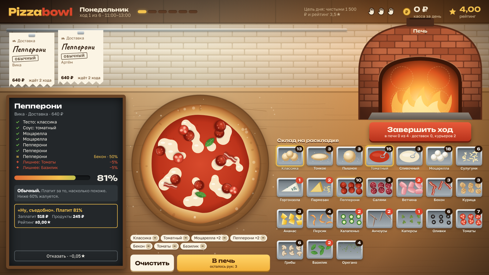

# Pizzabowl

Пошаговый менеджер пиццерии. Ты сам собираешь каждую пиццу по канону архетипа (Маргарита, Гавайская, Римская…) из того, что есть на складе, а склада никогда не хватает.

Концепция: https://claude.ai/artifact/9kR6J1fv5ryTSMkNdfzeWW



Сейчас играбелен первый кусок плана: один день из 6 ходов. Тикеты на планке, раскладка, процент канона, реакции клиентов (обычный, пурист, авантюрист), печь на 4 места, курьеры, события в начале хода и итог дня с арендой.

## Запуск

Сборки нет, это статические файлы и ES-модули.

```sh
npm start          # python3 -m http.server 8000, затем открыть http://localhost:8000
npm test           # юнит-тесты логики (Node 20+)
npm run balance    # жадный бот играет 300 дней и печатает, как часто выполняется цель
```

## Структура

| Файл | Что внутри |
| --- | --- |
| `src/data.js` | Ингредиенты, сходство замен, архетипы, клиенты, стартовый склад, события |
| `src/core.js` | Логика без DOM: процент канона, реакции, ходы, итог дня |
| `src/art.js` | Векторная графика: кухня, печь, пицца, лотки, иконки |
| `src/main.js` | Экран 1920×1080, масштабируется целиком; окна поверх |
| `tests/` | Тесты и бот для баланса |

Публикация на GitHub Pages отключена.
